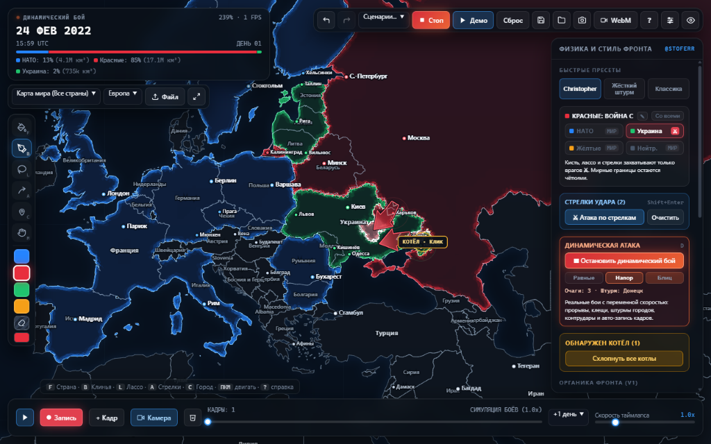

# FRONTLINE STUDIO

**Процедурная студия картографии боевых действий и таймлапсов линий фронта в одном HTML-файле** (в визуальном стиле **Christopher / @stoferr**).

Открывается двойным кликом в любом современном браузере — без сборки, серверов и зависимостей. Вся графика рендерится в нативном разрешении на **GPU (WebGL2 / WebGL1)** при 60+ FPS.

---

## Скачать и запустить

1. Перейдите в раздел **[Releases](../../releases/latest)** и скачайте файл **`index.html`**.
2. Откройте `index.html` в Chrome, Edge, Firefox или Brave.
3. При первом запуске загрузится векторный атлас мира `1:50m` (`world-atlas`) и автоматически сохранится в **IndexedDB** — дальше карта мира работает мгновенно и полностью **оффлайн**.

---

## Ключевые возможности

### Рендеринг и физика фронта (WebGL2 GPU)
- **Органика фронта v1:** 4-октавный мировой Simplex Noise, острые микро-зубцы, объёмный полупрозрачный тыл, неоновый `Inner Glow` и спокойное фоновое дыхание.
- **100% независимость от зума (35%–1400%):** форма линии фронта зафиксирована в мировых координатах — при приближении и отдалении камеры контур не «плывёт» и не мылится.
- **4K-выравнивание мирных границ (`4096×2238`):** мирные государственные границы и береговые линии ложатся 1-в-1 на векторные полигоны стран без лесенок и закруглений углов.
- **Белая линия активного захвата (стиль Christopher):** в покое отображается чистый насыщенный цвет фракции, а во время активного наступления, прорыва или таймлапса передняя кромка вспыхивает ярко-белым и плавно гаснет после остановки.
- **Монотонное продвижение (Eikonal / Dijkstra):** переходы между кадрами, волны лассо и схлопывание котлов катятся цельной связной волной с учётом сопротивления местности.

### Инструменты картографа
- **Заливка страны (`F`):** мгновенная покраска любого из 240 государств мира без анимации.
- **Кисть прорыва (`B`):** танковые клинья, зависящие от скорости движения курсора, с отложенным подтягиванием флангов.
- **Живое лассо (`L`):** обведите область наступления — волна захвата органично прокатится от линии соприкосновения.
- **Тактические стрелки удара (`A`) + «Атака по стрелкам» (`Shift+Enter`):** анимированные стрелки с бегущими шевронами `>>>`, сохраняющиеся в ключевых кадрах, и авто-наступление по нарисованному плану.
- **Динамические города (`C`):** встроенная база из 46 ключевых городов мира + добавление своих опорных пунктов; точки автоматически меняют цвет при захвате с импульсной волной.
- **Дипломатия (`⚔ / МИР`):** матрица войн `5×5` — фракции воюют только с выбранными противниками, не задевая мирных соседей и нейтралов. Переименование и настройка цвета любой фракции.
- **Окружения (Котлы):** честная детекция котлов с учётом выхода к морю и третьих сторон, диагональная штриховка, ручное и авто-схлопывание.

### ⚡ Динамическая атака (`D`) — симулятор реальных боёв
- Автономная симуляция живого фронта с **переменной случайной скоростью**: одновременно работают 3–7 очагов — танковые прорывы, фланговые клещи (способные реально окружать котлы), позиционные качели и внезапные контрудары.
- **Штурмы городов:** замедление темпа и ожесточённые уличные бои перед падением крупных городов.
- **3 режима инициативы:** `Равные`, `Напор`, `Блиц`.
- Игровые часы тикают в реальном времени, а при активной **Записи** кадры таймлапса фиксируются автоматически.

### Таймлапс, сценарии и экспорт
- **Плавная камера (`Камера`):** каждый ключевой кадр запоминает позицию и зум; при проигрывании камера плавно летит между кадрами.
- **Готовые сценарии в 1 клик:** Демо (Котёл в Европе), Восточный фронт, Европа 1939 (ВМВ), Ближний Восток, Тихий океан / Азия, Чистая карта мира, а также загрузка своих карт (PNG/JPG/WebP) перетаскиванием.
- **Точная статистика в `км²`:** поклеточный расчёт площади с поправкой широты Web Mercator $\cos^2(\varphi)$.
- **Экспорт:** запись таймлапса в **WebM** (с автоматической блокировкой камеры во время рендера), чистый **PNG-скриншот** без HUD, сохранение и загрузка проектов **`.frontline.json`** с RLE-сжатием (`Ctrl+S`).

---

## Горячие клавиши

| Клавиша | Действие |
|---|---|
| `F` | Заливка страны (мгновенно) |
| `B` | Кисть прорыва (клинья и фланги) |
| `L` | Живое лассо |
| `A` | Стрелка удара |
| `C` | Поставить город / опорный пункт |
| `M` / `ПКМ` / `Пробел+ЛКМ` | Панорама карты |
| `D` | Запустить / остановить «Динамическую атаку» |
| `Shift + Enter` | Атака по всем стрелкам |
| `1–4` / `5` | Выбор фракции / Ластик |
| `[` / `]` | Уменьшить / увеличить кисть |
| `K` | Записать ключевой кадр с позицией камеры |
| `P` | Старт / Пауза таймлапса |
| `H` | Режим кино (скрыть интерфейс) |
| `Ctrl + Z` / `Ctrl + Y` | Отменить / Повторить |
| `Ctrl + S` | Сохранить проект (`.frontline.json`) |
| `0` | Показать всю карту |
| `?` / `F1` | Справка по горячим клавишам |

---

## Стек и архитектура

- **100% Vanilla HTML / CSS / JavaScript** в едином самодостаточном файле (`index.html`).
- **WebGL2 / WebGL1 Fragment Shader** — полноэкранный рендер за 1 draw call + инкрементальные `texSubImage2D` dirty-rect обновления.
- **2D Canvas Overlay** — нативные векторные границы, анимированные тактические стрелки, динамические города и бродкаст-штампы.
- **world-atlas (`countries-50m.json`) + IndexedDB** — векторная карта мира в проекции Web Mercator с оффлайн-кэшированием.
